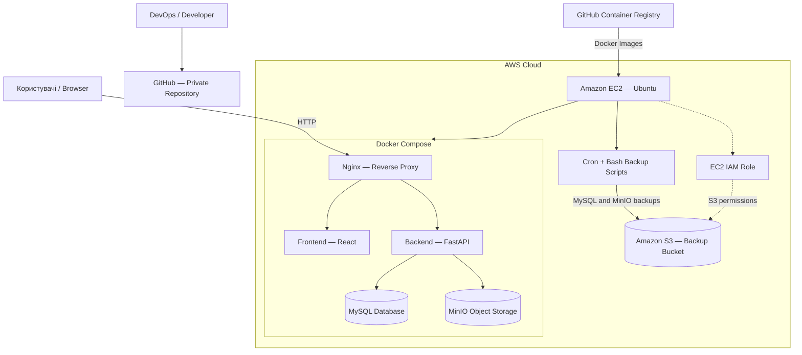

# Hyggy — AWS Infrastructure Architecture

## Загальна архітектура

## Основні компоненти

| Компонент | Призначення |
|---|---|
| GitHub | Зберігання вихідного коду та DevOps-конфігурацій |
| GHCR | Реєстр Docker-образів |
| Amazon EC2 | Сервер розгортання застосунку |
| Docker Compose | Керування контейнерами |
| Nginx | Зворотний проксі-сервер |
| React | Клієнтська частина |
| FastAPI | Серверна частина |
| MySQL | Реляційна база даних |
| MinIO | Об'єктне сховище файлів |
| Cron + Bash | Автоматизація резервного копіювання |
| IAM Role | Надання EC2 дозволів для роботи з S3 |
| Amazon S3 | Зберігання резервних копій |

## Розгортання Hyggy на AWS EC2 (Production)

Для production-розгортання використовується Docker Compose v2+.

Конфігураційні файли:
- `jysk-project/devops/docker-compose.prod.yml`
- `jysk-project/devops/nginx/default.conf`

Перед запуском необхідно встановити Docker Engine із Compose plugin
та підготувати файл `jysk-project/devops/.env`.

Необхідні змінні середовища:
- `PUBLIC_HOST` — публічна IP-адреса або домен сервера без `http://`.
- `MYSQL_ROOT_PASSWORD` — пароль адміністратора MySQL.
- `MYSQL_PASSWORD` — пароль користувача MySQL.
- `MINIO_ROOT_USER` — обліковий запис адміністратора MinIO.
- `MINIO_ROOT_PASSWORD` — пароль адміністратора MinIO.
- `JWT_SECRET` — секретний ключ для підпису JWT.

У production необхідно використовувати власні надійні секрети.
Файл `.env` виключений із Git через `.gitignore`.
Не додавайте його до репозиторію.

Для отримання приватних образів GHCR може знадобитися
автентифікація Docker із відповідними правами.

Запуск із каталогу `jysk-project/devops`:

    docker compose -f docker-compose.prod.yml up -d

Перевірка контейнерів:

    docker compose -f docker-compose.prod.yml ps

Перевірка Backend Healthcheck:

    docker compose -f docker-compose.prod.yml ps backend

Публічний HTTP-доступ забезпечує Nginx через порт 80.
HTTPS потребує окремого налаштування TLS.

## Моніторинг працездатності Backend (Healthcheck)

Для Backend FastAPI налаштовано Docker Healthcheck у
`~/hyggy-deploy/docker-compose.yml` на Amazon EC2.

- Перевірка: HTTP GET http://127.0.0.1:8000/docs
- Інструмент: Python urllib.request усередині контейнера.
- Інтервал: 30 секунд.
- Тайм-аут: 5 секунд.
- Кількість невдалих перевірок: 3.
- Початковий період: 30 секунд.

Перевірка стану: `docker compose ps`.
Детальна діагностика: `docker inspect hyggy-deploy-backend-1`.

Після впровадження підтверджено статус `healthy`.
Frontend та Backend API відповідають HTTP 200 через Nginx.

Healthcheck перевіряє доступність HTTP-сервера, але не
гарантує працездатність MySQL, MinIO або всіх API-функцій.
Статус `unhealthy` сам по собі не спричиняє перезапуск
контейнера Docker Compose.

## Резервне копіювання

Для резервного копіювання MySQL та MinIO використовуються Bash-скрипти, які запускаються через Cron.

Розклад (UTC):

- 03:00 — резервне копіювання MySQL.
- 03:15 — резервне копіювання MinIO.

S3 bucket: `hyggy-backups-920503695956`

Каталоги:

- `mysql/`
- `minio/`

Ручне виконання обох скриптів та завантаження резервних копій до S3 успішно перевірено 27 жовтня 2026 року.

Автоматичне виконання за розкладом потребує окремої перевірки.

## Посилання

- [Розгорнутий сайт Hyggy](http://13.61.146.163/)
- [GitHub-репозиторій](https://github.com/V88-crypto/jysk-devops-infra)
- [Архітектура локального середовища](../jysk-project/README.md#архітектура-локального-середовища)
