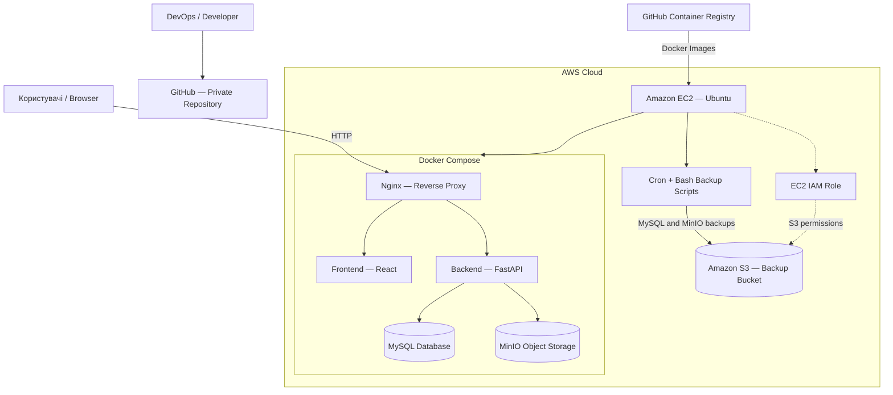

# Hyggy — AWS Infrastructure Architecture

## Загальна архітектура

## Основні компоненти

| Компонент | Призначення |
|---|---|
| GitHub | Зберігання вихідного коду та DevOps-конфігурацій |
| GHCR | Реєстр Docker-образів |
| Amazon EC2 | Сервер розгортання застосунку |
| Docker Compose | Керування контейнерами |
| Nginx | Зворотний проксі-сервер |
| React | Клієнтська частина |
| FastAPI | Серверна частина |
| MySQL | Реляційна база даних |
| MinIO | Об'єктне сховище файлів |
| Cron + Bash | Автоматизація резервного копіювання |
| IAM Role | Надання EC2 дозволів для роботи з S3 |
| Amazon S3 | Зберігання резервних копій |

## Резервне копіювання

Для резервного копіювання MySQL та MinIO використовуються Bash-скрипти, які запускаються через Cron.

Розклад (UTC):

- 03:00 — резервне копіювання MySQL.
- 03:15 — резервне копіювання MinIO.

S3 bucket: `hyggy-backups-920503695956`

Каталоги:

- `mysql/`
- `minio/`

Ручне виконання обох скриптів та завантаження резервних копій до S3 успішно перевірено 27 жовтня 2026 року.

Автоматичне виконання за розкладом потребує окремої перевірки.

## Посилання

- [Розгорнутий сайт Hyggy](http://13.61.146.163/)
- [GitHub-репозиторій](https://github.com/V88-crypto/jysk-devops-infra)
- [Архітектура локального середовища](../jysk-project/README.md#архітектура-локального-середовища)
